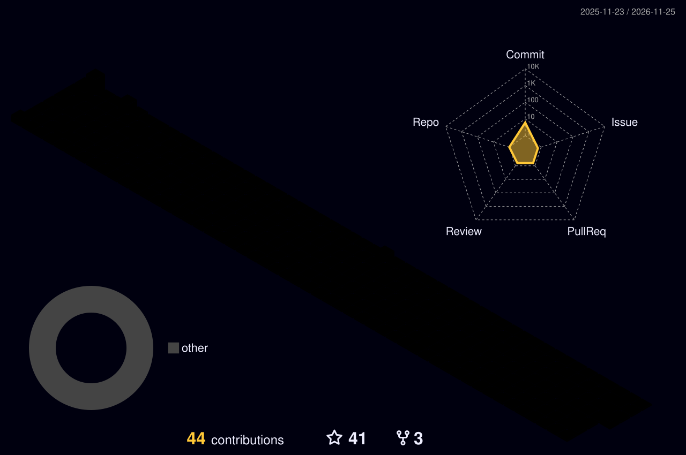

<!-- ╔══════════════════════════════ HEADER ══════════════════════════════╗ -->
<p align="center">
  
</p>

<p align="center">
  
</p>

<p align="center">
  
  <a href="https://github.com/Harsh-bartariya?tab=followers"></a>
  <a href="https://github.com/Harsh-bartariya?tab=repositories"></a>
</p>


<!-- ╔══════════════════════════════ ABOUT (neofetch style) ══════════════════════════════╗ -->
## `$ whoami`

<table>
<tr>
<td width="55%" valign="top">

```bash
harsh@github:~$ neofetch
```
```yaml
 ██╗  ██╗    harsh@github
 ██║  ██║    ─────────────────────────────
 ███████║    OS        : Developer OS v2026
 ██╔══██║    Role      : Software Developer
 ██║  ██║    Building  : PHP & Python apps
 ╚═╝  ╚═╝    Learning  : APIs · AI · LLMs
             Ask me    : Java · C
             Badge     : Internshala ISP '19
             Goal      : Ship open-source 🚀
             Uptime    : Coding since forever
             Exception : Uncatchable 😎
```

</td>
<td width="45%" align="center" valign="middle">


</td>
</tr>
</table>

<details>
<summary><b>⚡ Quick facts — click to expand</b></summary>
<br/>

| | |
|---|---|
| 🔭 **Currently working on** | PHP & Python projects |
| 🌱 **Currently learning** | REST APIs, Generative AI, LLM apps |
| 👯 **Open to** | Collaborations & interesting opportunities |
| 🧠 **Problem solving** | [CodeChef](https://www.codechef.com/users/v_machine_786) · [HackerRank](https://www.hackerrank.com/Harshmachine7861) |
| 💬 **Ask me about** | Java, C, backend development |
| ⚡ **Fun fact** | I am an *Exception*, you can't `catch` me |

</details>


<!-- ╔══════════════════════════════ TECH STACK ══════════════════════════════╗ -->
## `$ ls ~/skills`

<div align="center">

| 💻 Languages | 🌐 Frontend | ⚙️ Backend & APIs | 🗄️ Databases | 🧰 Tools |
|:---:|:---:|:---:|:---:|:---:|
|  |  |  |  |  |

</div>


<!-- ╔══════════════════════════════ ANALYTICS ══════════════════════════════╗ -->
## `$ git log --stats`

<div align="center">

<!-- 3D contribution skyline (auto-generated by .github/workflows/profile-3d.yml) -->


<br/><br/>


</div>

<!-- ╔══════════════════════════════ SNAKE ══════════════════════════════╗ -->
<p align="center">
  <picture>
    <source media="(prefers-color-scheme: dark)" srcset="https://raw.githubusercontent.com/Harsh-bartariya/Harsh-bartariya/output/github-snake-dark.svg" />
    <source media="(prefers-color-scheme: light)" srcset="https://raw.githubusercontent.com/Harsh-bartariya/Harsh-bartariya/output/github-snake.svg" />
    
  </picture>
</p>


<!-- ╔══════════════════════════════ QUOTE ══════════════════════════════╗ -->
<p align="center">
  
</p>

<!-- ╔══════════════════════════════ CONNECT ══════════════════════════════╗ -->
## `$ ping harsh`

<p align="center">
  <a href="https://www.linkedin.com/in/harsh-saxena-3ba1491a4/"></a>
  <a href="mailto:Harshmachine786war@gmail.com"></a>
  <a href="https://github.com/Harsh-bartariya"></a>
  <a href="https://www.codechef.com/users/v_machine_786"></a>
  <a href="https://www.hackerrank.com/Harshmachine7861"></a>
</p>

<!-- ╔══════════════════════════════ FOOTER ══════════════════════════════╗ -->
<p align="center">
  
</p>
