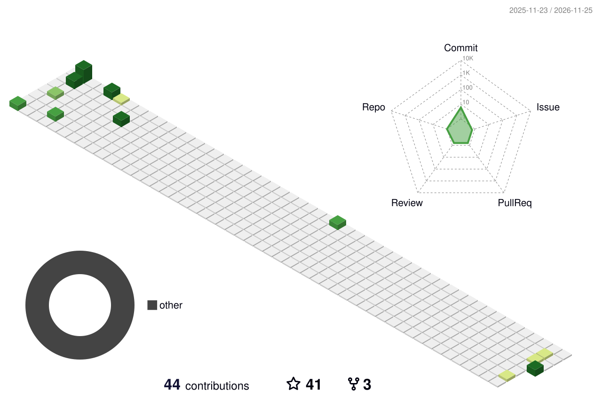

<h1 align="center">
  HARSH&nbsp;&nbsp;&nbsp;&nbsp;BARTARIYA
</h1>

<code>&lt;/&gt; Code • Build • Break • Repeat</code>

  <picture>
    <source media="(prefers-color-scheme: dark)" srcset="https://readme-typing-svg.demolab.com?font=JetBrains+Mono&weight=700&size=24&duration=3000&pause=800&color=3B82F6&center=true&vCenter=true&width=700&height=50&lines=%3E+Initializing+Harsh.exe+...;%3E+PHP+%7C+Python+%7C+Java+%7C+C;%3E+Building+with+APIs+%26+AI+%F0%9F%A4%96;%3E+throw+new+Exception(%22Can't+catch+me%22)%3B" />
    
  </picture>

  
  <a href="https://github.com/Harsh-bartariya?tab=followers">
    <picture>
      <source media="(prefers-color-scheme: dark)" srcset="https://img.shields.io/github/followers/Harsh-bartariya?label=FOLLOWERS&style=for-the-badge&color=1D4ED8&labelColor=0D1117&logo=github&logoColor=60A5FA" />
      
    </picture>
  </a>
  <a href="https://github.com/Harsh-bartariya?tab=repositories">
    <picture>
      <source media="(prefers-color-scheme: dark)" srcset="https://img.shields.io/github/stars/Harsh-bartariya?affiliations=OWNER&label=STARS&style=for-the-badge&color=2563EB&labelColor=0D1117&logo=starship&logoColor=93C5FD" />
      
    </picture>
  </a>

## `$ whoami`

<table>
  <tr>
    <td width="55%" valign="top">
<pre>
harsh@github:~$ neofetch

 ██╗  ██╗    harsh@github
 ██║  ██║    ─────────────────────────────
 ███████║    OS        : Developer OS v2026
 ██╔══██║    Role      : Software Developer
 ██║  ██║    Building  : PHP &amp; Python apps
 ╚═╝  ╚═╝    Learning  : APIs · AI · LLMs
             Ask me    : Java · C
             Badge     : Internshala ISP '19
             Goal      : Ship open-source 🚀
             Uptime    : Coding since forever
             Exception : Uncatchable 😎
</pre>
    </td>
    <td width="45%" align="center" valign="middle">
      
    </td>
  </tr>
</table>

<b>⚡ Quick facts</b>

 

| | |
|---|---|
| 🔭 **Currently working on** | PHP & Python projects |
| 🌱 **Currently learning** | REST APIs, Generative AI, LLM apps |
| 👯 **Open to** | Collaborations & interesting opportunities |
| 🧠 **Problem solving** | [CodeChef](https://www.codechef.com/users/v_machine_786) · [HackerRank](https://www.hackerrank.com/Harshmachine7861) |
| 💬 **Ask me about** | Java, C, backend development |
| ⚡ **Fun fact** | I am an *Exception*, you can't `catch` me |

## `$ ls ~/skills`

<table>
  <tr>
    <th>💻 Languages</th><th>🌐 Frontend</th><th>⚙️ Backend &amp; APIs</th><th>🗄️ Databases</th><th>🤖 AI / LLM</th><th>🧰 Tools</th>
  </tr>
  <tr>
    <td align="center"><picture><source media="(prefers-color-scheme: dark)" srcset="https://skillicons.dev/icons?i=java,c,php,python,js&perline=3&theme=dark" /></picture></td>
    <td align="center"><picture><source media="(prefers-color-scheme: dark)" srcset="https://skillicons.dev/icons?i=html,css,react&perline=2&theme=dark" /></picture></td>
    <td align="center"><picture><source media="(prefers-color-scheme: dark)" srcset="https://skillicons.dev/icons?i=fastapi,nodejs,graphql,postman&perline=2&theme=dark" /></picture></td>
    <td align="center"><picture><source media="(prefers-color-scheme: dark)" srcset="https://skillicons.dev/icons?i=mysql,mongodb&perline=1&theme=dark" /></picture></td>
    <td align="center">
       
       
       
       
      
    </td>
    <td align="center"><picture><source media="(prefers-color-scheme: dark)" srcset="https://skillicons.dev/icons?i=git,github,vscode,bash,linux&perline=3&theme=dark" /></picture></td>
  </tr>
</table>

## `$ git log --stats`

<picture>
  <source media="(prefers-color-scheme: dark)" srcset="https://raw.githubusercontent.com/Harsh-bartariya/Harsh-bartariya/main/profile-3d-contrib/profile-night-rainbow.svg" />
  
</picture>

  

<picture>
  <source media="(prefers-color-scheme: dark)" srcset="https://github-readme-stats.vercel.app/api?username=Harsh-bartariya&show_icons=true&count_private=true&include_all_commits=true&rank_icon=github&theme=dark&hide_border=true&bg_color=0D1117&title_color=3B82F6&icon_color=60A5FA&text_color=E6EDF3&ring_color=1D4ED8" />
  
</picture>
<picture>
  <source media="(prefers-color-scheme: dark)" srcset="https://github-readme-stats.vercel.app/api/top-langs/?username=Harsh-bartariya&layout=donut-vertical&langs_count=6&theme=dark&hide_border=true&bg_color=0D1117&title_color=3B82F6&text_color=E6EDF3" />
  
</picture>

  

<picture>
  <source media="(prefers-color-scheme: dark)" srcset="https://streak-stats.demolab.com?user=Harsh-bartariya&theme=dark&hide_border=true&background=0D1117&ring=1D4ED8&fire=3B82F6&currStreakLabel=60A5FA&sideLabels=93C5FD&dates=9CA3AF&card_width=800" />
  
</picture>

  

<picture>
  <source media="(prefers-color-scheme: dark)" srcset="https://github-profile-summary-cards.vercel.app/api/cards/profile-details?username=Harsh-bartariya&theme=github_dark" />
  
</picture>

  

  

<picture>
  <source media="(prefers-color-scheme: dark)" srcset="https://raw.githubusercontent.com/Harsh-bartariya/Harsh-bartariya/output/github-snake-dark.svg" />
  
</picture>

  <picture>
    <source media="(prefers-color-scheme: dark)" srcset="https://quotes-github-readme.vercel.app/api?type=horizontal&theme=tokyonight&border=false" />
    
  </picture>

## `$ ping harsh`

  <a href="https://www.linkedin.com/in/harsh-saxena-3ba1491a4/"><picture><source media="(prefers-color-scheme: dark)" srcset="https://img.shields.io/badge/LinkedIn-0D1117?style=for-the-badge&logo=linkedin&logoColor=3B82F6" /></picture></a>
  <a href="mailto:Harshmachine786war@gmail.com"><picture><source media="(prefers-color-scheme: dark)" srcset="https://img.shields.io/badge/Gmail-0D1117?style=for-the-badge&logo=gmail&logoColor=3B82F6" /></picture></a>
  <a href="https://github.com/Harsh-bartariya"><picture><source media="(prefers-color-scheme: dark)" srcset="https://img.shields.io/badge/GitHub-0D1117?style=for-the-badge&logo=github&logoColor=3B82F6" /></picture></a>
  <a href="https://www.codechef.com/users/v_machine_786"><picture><source media="(prefers-color-scheme: dark)" srcset="https://img.shields.io/badge/CodeChef-0D1117?style=for-the-badge&logo=codechef&logoColor=3B82F6" /></picture></a>
  <a href="https://www.hackerrank.com/Harshmachine7861"><picture><source media="(prefers-color-scheme: dark)" srcset="https://img.shields.io/badge/HackerRank-0D1117?style=for-the-badge&logo=hackerrank&logoColor=3B82F6" /></picture></a>

<picture>
  <source media="(prefers-color-scheme: dark)" srcset="https://capsule-render.vercel.app/api?type=waving&color=0:0A192F,50:1E3A8A,100:2563EB&height=140&section=footer&text=Thanks%20for%20visiting!&fontSize=24&fontColor=DBEAFE&fontAlignY=70" />
  
</picture>
